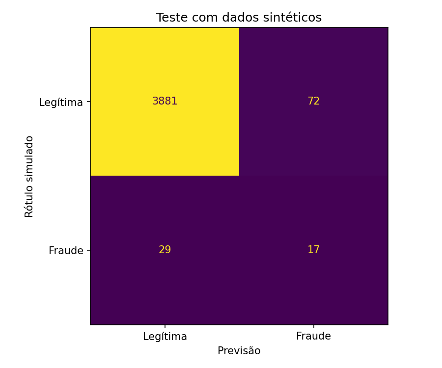
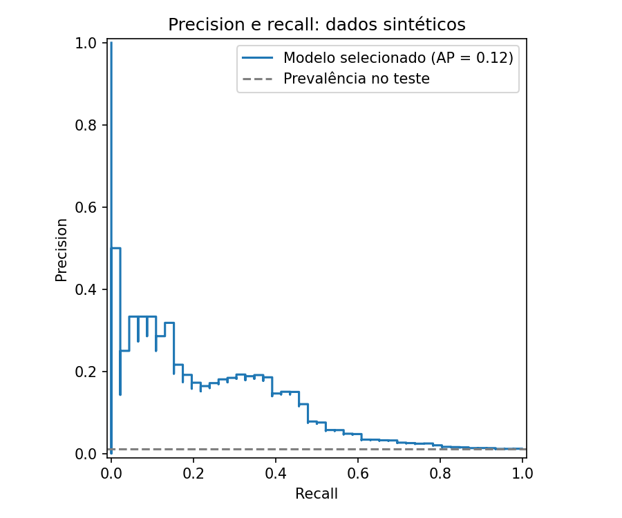

# Execução de referência

Dados sintéticos. Estes números não medem desempenho bancário real.

Modelo escolhido na validação: `random_forest`.
Limiar escolhido na validação: 0.701773.

| Medida no teste | Resultado |
| --- | ---: |
| Transações | 3999 |
| Fraudes simuladas | 46 |
| Precision | 19.10% |
| Recall | 36.96% |
| Average precision | 0.1238 |
| F2 | 0.3114 |
| Taxa de alertas | 2.23% |
| Alarmes falsos | 72 |
| Fraudes não detectadas | 29 |

O modelo sinalizou 17 fraudes simuladas e deixou passar
29. Entre os alertas, 72 eram transações legítimas.
O F2 favorece recall, mas essa escolha pode aumentar o volume de revisão.

O arquivo `metricas.json` inclui a comparação na validação, o baseline que
sempre prevê transação legítima e o resultado com limiar padrão de 0,5.

## Condições da execução

Base de 20.000 transações sintéticas, semente 42. Versões: Python 3.12.14,
numpy 2.3.5, pandas 2.2.3, scikit-learn 1.8.0, joblib 1.5.3 e matplotlib 3.10.8.
O detalhamento completo está em [metricas.json](metricas.json).

O treino recebeu 12.001 transações, a validação 4.000 e o teste 3.999.
O teste continha 46 fraudes simuladas. O modelo encontrou 17, deixou passar 29
e gerou 72 alarmes falsos. Esse resultado mostra que ainda há muitos erros;
não é uma demonstração de um sistema pronto para uso.

O baseline atingiu 98,85% de acurácia sem encontrar nenhuma fraude.
O modelo selecionado teve 97,47% de acurácia, com recall de 36,96%.
Essa comparação ajuda a entender por que acurácia sozinha não resolve o problema.

Na validação, a Random Forest teve average precision de 0,1493, contra 0,0967
da Regressão Logística. Essa foi a comparação usada para escolher o modelo.

No teste, o limiar padrão de 0,5 obteve F2 de 0,3203, enquanto o limiar escolhido
na validação obteve 0,3114. Eu mantenho a decisão feita na validação. Ajustar
o limiar depois de olhar esse resultado passaria a usar o teste para decidir.

Os seis testes automatizados passaram, e o fluxo de geração, treinamento,
relatórios e previsão foi executado no ambiente acima. O workflow do GitHub
está configurado; a execução hospedada só acontece depois da publicação.
